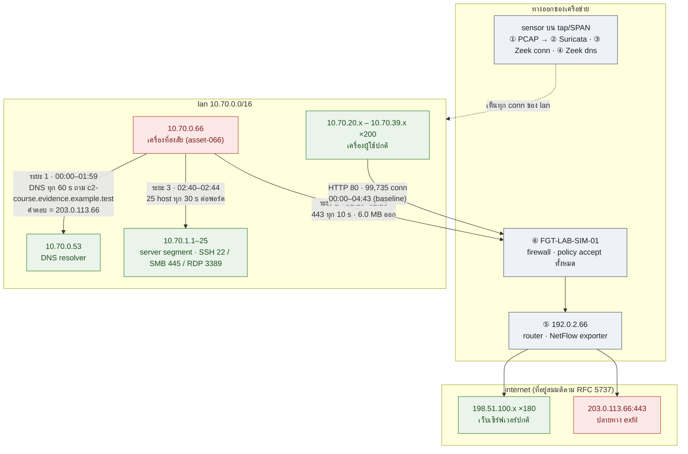

# M6.10 — แทร็ก lab: SOC Automation ด้วย Claude + MCP (คนเป็นผู้ตรวจ)

ผู้รับผิดชอบ: ครูเอ้ · ร่าง 2026-11-02 สำหรับคาบ 2026-11-03 · ศัพท์ดูใน [glossary](../../docs/glossary.md) · tool ทั้ง 37 ตัวของ MCP ทั้งสอง server อธิบายไทยพร้อมต้นฉบับอังกฤษใน [mcp-tools-reference.md](mcp-tools-reference.md) · ที่มาของโครง: [บันทึกถาม-ตอบ Q9–Q10](../../docs/qa-2026-11-02-mcp-spark-hdfs.md)

## อ่านตรงนี้ก่อน (เล่าสั้น ๆ ว่าแทร็กนี้คืออะไร)

สมมติว่าน้องเพิ่งเข้าทีม SOC และพี่มีเวลาห้านาทีอธิบายว่าครึ่งวันนี้เราจะทำอะไรกัน

**เรามี SIEM แบบไม่มีหน้าจอ** ปกติน้องนั่งหน้า QRadar แล้วคลิก แต่วันนี้เราจะทำงานเดียวกันด้วยการพิมพ์คุยกับ Claude ซึ่งมีเครื่องมือ 2 ชุดต่ออยู่ ชุดแรกแตะข้อมูลได้ อ่าน log นับ จับคู่ รัน Spark job ชุดที่สองเป็นกติกา บอกว่า parser ไหนได้รับอนุมัติ โค้ดต้องหน้าตาแบบไหน รายงานถูกต้องไหม Claude ทำงานแทนมือเรา แต่ตัดสินใจแทนเราไม่ได้ และห้ามเชื่อตัวเลขที่มันพูดโดยไม่ชี้ว่ามาจากเครื่องมือไหน นี่คือกติกาข้อเดียวของทั้งวัน

**มีเคสหนึ่งรอน้องอยู่** คืนวันที่ 24 ส.ค. 2026 เครื่อง 10.70.0.66 ถาม DNS ซ้ำทุก 60 วินาทีอยู่สองชั่วโมง เงียบไปสิบนาที แล้วส่งข้อมูลออกไปหา IP ที่ DNS ตอบมา 6 MB ในยี่สิบนาที เงียบอีกสิบนาที แล้วเปิด connection ไปหาเครื่องข้างเคียง 25 เครื่องใน 4 นาที เครื่องละ 1 พอร์ตในกลุ่ม SSH/SMB/RDP แล้วปิดทันทีโดยไม่ login (ไม่ใช่ port scan แต่เป็นการแตะบริการควบคุมระยะไกลแบบเลือกเป้า) ทั้งหมดถูกบันทึกโดย sensor บนสาย ไม่ใช่โดยเครื่อง 25 เครื่องนั้น และเก็บไว้ 6 ไฟล์ (PCAP, Zeek, Suricata, NetFlow, firewall) ซึ่งทุกไฟล์มาจาก PCAP ก้อนเดียวกัน แปลว่ามันเล่าเรื่องตรงกันเพราะเป็นข้อมูลเดียวกัน ไม่ใช่เพราะยืนยันกัน เรื่องเต็มอยู่ในส่วน [เรื่องราวในชุดข้อมูล](#เรื่องราวในชุดข้อมูล-อ่านก่อนเริ่ม-lab)

**งานของน้องคือเดินตามเคสนี้ 9 ก้าว** แต่ละก้าวคือ lab หนึ่งไฟล์

1. **lab 0** เปิดกล่องเครื่องมือ ดูว่า Claude มีอะไรให้ใช้และอะไรทำไม่ได้
2. **lab 1** เอา log บรรทัดหนึ่งไปถามว่า "SIEM เรา parse ได้ไหม" แล้วดูว่า parse แล้วเห็นอะไรที่ก่อน parse ไม่เห็น
3. **lab 2** สั่งทำรายงาน IDS ทั้ง 340 alert บน Spark แล้วตรวจว่าโค้ดที่รันคือโค้ดที่ตรวจแล้วจริง ด้วย sha256
4. **lab 3** ร้อยสามระยะของเครื่อง .66 เข้าด้วยกัน จับคู่ alert กับ connection จริง และเปิด packet ดู
5. **lab 3c** ตั้งคำถามกลับ ถ้าไม่มี rule เลย เครื่องนี้จะโดดออกมาไหม ทำ baseline จาก 200 เครื่องปกติ
6. **lab 3b** เขียน handoff ส่งทีม IR แบบที่ตรวจซ้ำได้ทุกตัวเลข
7. **lab 2b** กลับด้าน คราวนี้ให้ Claude เขียนโค้ดเองแล้วน้องเป็นคนอ่านโค้ด รวม 340 alert เป็น 39 เรื่อง แล้วพบว่าคะแนนความสำคัญชนเพดานหมด
8. **lab 4** เอา IP ปลายทางไปถาม threat feed แล้วเรียนรู้ว่า "ไม่เจอ" ไม่ใช่ "สะอาด"
9. **lab 5** ทำรายงานหนึ่งหน้าให้ผู้บริหาร โดยใช้คำว่า rule ตรง ไม่ใช่ถูกโจมตี

ทุก lab โครงเดียวกัน โจทย์ → prompt แรกที่พิมพ์ → คำถามที่ถาม Claude ต่อทีละข้อ → ลำดับ tool ที่ควรเห็น → (เฉลย) → จุดที่คนต้องทำ → Claude ผิดตรงไหนได้บ้าง น้องกรอกคำตอบในไฟล์แล้วส่ง พี่ตรวจกับเฉลยที่มีตัวเลขจากการรันจริง

**หน้านี้ยาวเพราะเป็นหน้าอ้างอิง ไม่ต้องอ่านเรียงบรรทัด** ใช้แบบนี้

| ถ้าน้องเป็น | อ่านส่วนไหน | ข้ามส่วนไหนได้ |
| --- | --- | --- |
| ผู้เรียน | [student/README.md](student/README.md) แล้วทำตามลำดับในนั้น กลับมาหน้านี้เฉพาะ [เรื่องราว](#เรื่องราวในชุดข้อมูล-อ่านก่อนเริ่ม-lab) และ [แผนที่เครือข่าย](#เครือข่ายในชุดข้อมูล) | แนวคิด, course outline, ก่อนสอน |
| ผู้สอน | [แนวคิด](#แนวคิด) → [รายการ lab](#รายการ-lab) → [ลำดับสอน](#ลำดับสอนที่แนะนำ-ครึ่งวัน) → [ก่อนสอน](#ก่อนสอน) แล้วเปิด [instructor/](instructor/) | ตารางไฟล์ 6 ไฟล์อ่านตอนเตรียม lab 3 |
| คนที่อยากรู้ว่าชุดนี้แทน SIEM ได้แค่ไหน | [SIEM 10 ฟังก์ชัน before & after](#siem-10-ฟังก์ชัน-before--after) และ [หัวข้อตาม course outline](#หัวข้อตาม-course-outline-ที่ครอบคลุม) | ที่เหลือ |

---

## แนวคิด

หัวข้อ M5.1–M6.4 สอนให้ผู้เรียน **เขียน Python เอง** เพื่อทำ automation แทร็กนี้เป็นส่วนหนึ่งของ Module 6 (Security Automation Project) และสอนอีกวิธี: ผู้เรียน **สั่ง Claude ให้ใช้เครื่องมือ (MCP) ทำงาน** แล้วทำหน้าที่ตรวจผลและอนุมัติ ตรงกับวัตถุประสงค์หลักสูตรข้อ 4 และคอลัมน์ "AI ทำได้ / คนต้องทำ" ใน [checklist ELK→QRadar](../../docs/elastic-siem-vs-qradar.md)

```
ผู้เรียน (prompt + ตรวจ + อนุมัติ)
   │
   ▼
Claude Desktop ── ดึง feed / ทำ PDF / Artifact (ออกเน็ตได้ ต้องขออนุญาต)
   │
   ├── MCP ① log-skill server   : resolve / test_parser / render_spark_job / validate_report / save_draft
   │
   └── MCP ② spark-hdfs server  : hdfs_* (อ่าน/เขียน/query/correlate/pcap) + spark_* (save/validate/submit/status/logs)
                                   │
                                   ▼
                              HDFS (/mcp/...) + Spark cluster (2 workers)
```

**หลักที่ server บังคับ และผู้เรียนต้องเข้าใจก่อนเริ่ม**

1. Claude ไม่ได้เขียน PySpark เอง แต่ render จาก template ที่เชื่อถือได้ แล้วตรวจ sha256 ว่าตรง (lab 2b จงใจกลับด้าน: Claude เขียนเองและคนต้องอ่านโค้ดแทน)
2. skill code อ่านได้อย่างเดียว ไม่รัน (`log_skill_read_resource` คืน text เฉย ๆ)
3. job ที่ submit มี snapshot โค้ด, sha256, idempotency key เก็บไว้ audit ย้อนหลังได้
4. parser ใหม่เป็น draft เสมอ ต้องมีคน promote ผ่าน Git
5. **ไม่เชื่อผล job จนกว่าสถานะเป็น `SUCCEEDED`** และ report ต้องผ่าน `log_skill_validate_report`
6. path: HDFS tool ใช้ virtual path (`/lab/x.log`) และคืน physical path (`/mcp/lab/x.log`) ส่งให้ Spark ต้องใช้ physical path; ห้ามส่ง `/mcp/...` กลับเข้า HDFS tool

## ข้อมูลที่ใช้ทุก lab

ชุด `incident-lab` ใน HDFS (`/student/agentic-siem/incident-lab/input/`) คือเครือข่ายจำลองหนึ่งแห่งที่ถูกบันทึกโดยอุปกรณ์ 5 ชนิดพร้อมกันในช่วง 2026-08-24 00:00–04:43 UTC ทุกไฟล์ถูกสร้างจาก PCAP ไฟล์เดียว (ฟิลด์ `evidence_origin="pcap-derived"`, `parentuid` ชี้กลับไป Zeek uid) จึง correlate ข้ามแหล่งได้ด้วย key เดียวกัน แต่ก็แปลว่า**ไม่มีไฟล์ไหนเป็นหลักฐานอิสระจากไฟล์อื่น** (ดู caveat ใน lab 3 และ 3b)

### เรื่องราวในชุดข้อมูล (อ่านก่อนเริ่ม lab)

เล่าแบบ analyst เล่าให้คนที่เพิ่งเข้าวงการฟัง ตัวเลขทุกตัวในเรื่องนี้ผู้เรียนจะค้นเองได้จาก tool ใน lab 3 และ 3c และทุกตัวถูกรันยืนยันแล้ว (ดู instructor/verification-2026-11-03.md)

**ใครเฝ้าอยู่** เครือข่ายนี้มีสายหลักเส้นหนึ่งที่ traffic ทุกอย่างวิ่งผ่าน มี sensor ต่อรับสำเนาจากสายนั้น (ไม่ได้อยู่ในเส้นทาง จึงไม่ขวางใคร) บน sensor มีสองโปรแกรม **Zeek** จดทุก connection ว่าใครคุยกับใคร พอร์ตอะไร กี่ byte โดยไม่ตัดสินถูกผิด และ **Suricata** ซึ่งเป็น IDS ที่ร้อง (alert) เมื่อ packet ตรงกฎ แต่ไม่ block นอกจากนี้มี router ที่ export NetFlow และ firewall ที่ขอบเครือข่ายซึ่งในชุดนี้เป็น log จำลอง สิ่งที่ไม่มีคือ log บนเครื่องผู้ใช้ (EDR, auth, process) ดังนั้นทั้งเรื่องเราเห็นได้เฉพาะสิ่งที่ผ่านสาย

**00:00 ถึง 01:59 ระยะที่ 1** เครื่อง 10.70.0.66 ถาม DNS server ภายใน (10.70.0.53) ว่าโดเมน c2-course.evidence.example.test อยู่ที่ไหน แล้วถามซ้ำทุก 60 วินาทีเป๊ะ 120 ครั้ง ส่วนเบี่ยงเบนของช่วงห่างเป็นศูนย์ คนไม่ทำแบบนั้น โปรแกรมที่ตั้งเวลาไว้ทำ พฤติกรรมนี้เรียกว่า beacon คือโปรแกรมบนเครื่องที่คอยเช็คอินกับผู้ควบคุม (C2, command and control) DNS ตอบว่าโดเมนนี้อยู่ที่ 203.0.113.66 ซึ่งเป็นช่วง IP สงวนสำหรับเอกสาร (RFC 5737) Suricata ร้องกฎ "C2 DNS" ทั้ง 120 ครั้งแต่ action คือ allowed ในชั่วโมงนี้ analyst ยังพูดได้แค่ "เห็นพฤติกรรมเหมือน C2" ไม่ใช่ "เครื่องถูกยึด" เพราะโปรแกรมถูกกฎหมายหลายตัวก็ถาม DNS เป็นจังหวะ

**01:59 ถึง 02:10 เงียบ 11 นาที** ไม่มีอุปกรณ์ใดบันทึกอะไรจากเครื่องนี้

**02:10 ถึง 02:29:50 ระยะที่ 2** เครื่องเดิมเปิด TCP ไป 203.0.113.66 พอร์ต 443 คือ IP เดียวกับที่ DNS ตอบเมื่อสองชั่วโมงก่อน แล้วทำซ้ำทุก 10 วินาที 120 ครั้ง แต่ละครั้งส่งออกประมาณ 50,085 byte ได้กลับมา 2 byte รวมออก 6,010,330 byte กลับ 240 byte รูปร่างแบบส่งอย่างเดียวคือการอัปโหลด Suricata ร้องกฎ "Outbound Transfer" และระบุว่าเป็น HTTP ธรรมดาบนพอร์ตที่ควรเป็น HTTPS ถ้าเปิด PCAP กรองคู่นี้จะได้ 480 packet ซึ่งคือ 120 connection คูณ 4 packet ไม่ใช่ 480 ครั้ง (กับดักเรื่องหน่วยนับที่เจอบ่อย)

**02:29:50 ถึง 02:40 เงียบ 10 นาที**

**02:40 ถึง 02:44 ระยะที่ 3** เครื่องเดิมเปิด connection ไปเครื่องในกลุ่ม server 10.70.1.1 ถึง .25 ครบ 25 เครื่อง สลับพอร์ต 22 (SSH), 445 (SMB), 3389 (RDP) ทุก 30 วินาทีต่อพอร์ต แต่ละครั้งส่ง 35 byte รับ 2 byte คือแค่เคาะประตู ไม่ได้ login Suricata ร้อง 100 ครั้งเพราะนับต่อ packet (4 ต่อ connection) ขณะที่ Zeek มี 25 connection นี่คือการสำรวจเครื่องข้างเคียง ยังไม่ใช่การบุกเข้าที่สำเร็จ และไม่มี log จากเครื่องปลายทางมายืนยัน

**02:44 เครื่อง 10.70.0.66 เงียบและไม่กลับมาอีก**

**03:20 ถึง 04:43 เครือข่ายตื่น** เครื่องผู้ใช้ 200 เครื่อง (10.70.20.x ถึง 10.70.39.x) เปิดเว็บพอร์ต 80 เครื่องละประมาณ 499 connection รวม 99,735 connection ออกเครื่องละประมาณ 28 KB นี่คือ baseline ของเครือข่าย ข้อสังเกตคือถ้าระยะที่ 3 เกิดในชั่วโมงนี้ 25 connection จะจมอยู่ใต้ traffic ปกติ กฎที่นับจำนวน connection จะมองไม่เห็น แต่กฎที่ดู byte ออกต่อเครื่องจะเห็นทันที เพราะเครื่องที่สงสัยออก 6 MB เทียบกับเครื่องปกติ 28 KB (ต่างกันประมาณ 212 เท่า) ทั้งที่จำนวน connection น้อยกว่าเครื่องปกติครึ่งหนึ่ง

**สิ่งที่เรื่องนี้ตั้งใจให้ผู้เรียนเจอ**

- ทั้ง Zeek, Suricata, NetFlow และ firewall ในชุดนี้มาจาก PCAP ก้อนเดียว เล่าเรื่องตรงกันเพราะเป็นข้อมูลเดียวกัน ไม่ใช่เพราะยืนยันกัน หลักฐานอิสระต้องมาจากที่อื่น เช่น บนเครื่อง
- alert ของ Suricata ทุกตัวมี severity 1 เท่ากัน คะแนนของ SIEM จึงชนเพดานและเรียงลำดับความสำคัญไม่ได้ (lab 2b) ต้องกลับไปดูตัวเลขดิบ
- คำถามที่ SOC ตอบจากสายไม่ได้คือ 6 MB นั้นคือข้อมูลอะไร และเครื่องถูกควบคุมจริงไหม คำตอบอยู่บน host งานของ lab คือส่งต่อ (lab 3b) ด้วยสถานะ needs-review พร้อมหลักฐานที่ตรวจซ้ำได้ ไม่ใช่เดาแทนทีม IR

### เครือข่ายในชุดข้อมูล



ตัวเลข ①–⑥ คือ log ในตารางถัดไป ระยะ 1–3 คือลำดับเหตุการณ์ของ 10.70.0.66 สีแดง = จุดที่เรื่องราวเกิด สีเขียว = traffic ปกติและเป้าหมายที่ถูกแตะ สีเทา = อุปกรณ์ที่ผลิต log

| ที่อยู่ | บทบาท | ที่มาของข้อสรุป |
| --- | --- | --- |
| 10.70.0.66 | workstation ที่เรื่องราวทั้งหมดเกิดขึ้น handoff เรียกว่า asset-066 | ทุก alert 340 รายการ, conn 265 รายการ |
| 10.70.0.53 | DNS resolver ภายใน ตอบ A record ให้ 10.70.0.66 | zeek dns: `id.resp_h` 10.70.0.53, `answers` 203.0.113.66 |
| 10.70.1.1–25 | server segment ที่ถูกไล่ต่อ SSH (9 เครื่อง), SMB (8), RDP (8) | conn + FortiGate policy SIM-EAST-WEST-REMOTE-SERVICE |
| 10.70.20.0–10.70.39.0 (/24 ×20) | 200 เครื่องผู้ใช้ปกติ แต่ละเครื่อง ~499 HTTP conn ตลอด 4 ชม. 43 นาที | lab 3c baseline |
| 198.51.100.x (180 host) | เว็บเซิร์ฟเวอร์ภายนอกที่ traffic ปกติไปหา | FortiGate policy SIM-BENIGN-WEB lan→wan |
| 203.0.113.66 | ปลายทาง exfil และเป็นคำตอบของโดเมน C2 ด้วย | zeek dns `answers` + conn พอร์ต 443 |
| 192.0.2.66 | router ที่ export NetFlow (engine_id 66, interface 1→2, AS 64512→64496) | netflow `exporter` |
| FGT-LAB-SIM-01 | firewall ระหว่าง lan กับ wan และระหว่าง segment ภายใน (ทุก conn ผ่าน) | fortigate `devname`, `srcintf`/`dstintf` |

### ไฟล์ทั้ง 6 และ "ทำไมต้องมี log นี้"

| # | ไฟล์ | ขนาด | มาจากอุปกรณ์ไหน อยู่ตรงไหน | บันทึกอะไร (ฟิลด์เด่น) | ตอบคำถามอะไรที่ไฟล์อื่นตอบไม่ได้ | ใช้ใน lab | parser |
| --- | --- | --- | --- | --- | --- | --- | --- |
| ① | coherent-course-100k.pcap | 61 MB | sensor บน tap/SPAN ที่เห็นทุก segment | ทุก packet ของ 100,000 conversation | หลักฐานระดับต่ำสุด: payload, handshake, ลำดับ packet ใช้เมื่อ log ข้างบนขัดกันหรือต้องพิสูจน์ว่า session เกิดจริง เป็น "ไฟล์แม่" ของอีก 5 ไฟล์ | 3 (ขั้น 5) | — ค้นด้วย `hdfs_pcap_packets` |
| ② | coherent-pcap-suricata-alerts-340.jsonl | 154 KB | IDS (Suricata 7) อ่าน PCAP เดียวกันด้วย rule 3 ตัว (sid 1300101–1300103) | signature, category, severity, 5-tuple, alert_action, alert_id | **ชื่อของพฤติกรรม** ตามที่คนเขียน rule ไว้ เป็นจุดเริ่มของ SOC แต่มีแค่สิ่งที่มี rule: 340 alert จาก 100,000 conn และทุก alert เป็น `allowed` (เห็นแต่ไม่ block) | 1, 2, 2b, 3 | suricata-eve-alert-json-v1 |
| ③ | coherent-pcap-zeek-conn-100k.jsonl | 37 MB | sensor เดียวกับ ① (Zeek 7) | 1 บรรทัดต่อ connection: uid, 5-tuple, orig/resp bytes และ packets, conn_state, duration | **ใครคุยกับใคร เท่าไร ทั้งเครือข่าย** รวม 99,735 conn ปกติที่ไม่มี alert ขาดไฟล์นี้จะไม่มี baseline, ไม่รู้ปริมาณ byte ออก และ join อะไรไม่ได้ (uid คือ key ร่วมของทุกไฟล์) | 3, 3c | zeek-conn-json-v1 |
| ④ | coherent-pcap-zeek-dns-120.jsonl | 52 KB | sensor เดียวกัน มุมมอง DNS | query, qtype, rcode, answers, TTL ทั้ง 120 บรรทัดคือ 10.70.0.66 ถาม `c2-course.evidence.example.test` A ได้ 203.0.113.66 TTL 60 | **คุยเรื่องอะไร**: conn.log บอกแค่ว่ามี UDP 53 ไป resolver ไฟล์นี้บอกชื่อโดเมนและคำตอบ จึงเป็นตัวเชื่อมระยะ 1 (beacon) เข้ากับระยะ 2 (exfil ไป IP ที่โดเมนนั้น resolve ได้) | 3b (เป็น input ของ c2-detection), 1 | zeek-dns-json-v1 |
| ⑤ | coherent-pcap-netflow-v5-100k.jsonl | 54 MB | router 192.0.2.66 ที่อยู่ระหว่าง lan กับ wan export NetFlow v5 | 1 flow ต่อ conn ทิศทางเดียว: bytes, packets, interface เข้า/ออก, AS, tcp_flags ไม่มี payload ไม่มี conn_state | **มุมมองของอุปกรณ์เครือข่ายเมื่อไม่มี sensor**: องค์กรส่วนใหญ่มี NetFlow ก่อนมี Zeek ใน QRadar คือ QFlow / ตาราง flows เทียบกับ ③ จะเห็นว่า conversation เดียวกันแต่ฟิลด์น้อยกว่าและแยกทิศ | 3b (input ของ exfiltration-detection) | netflow-v5-pcap-course-exfil-json-v1 |
| ⑥ | coherent-pcap-fortigate-100k.log | 48 MB | firewall FGT-LAB-SIM-01 ที่ทุก conn ผ่าน (lan→wan และ lan→lan) | key=value ของ FortiOS: srcintf/dstintf, policyname, action, sentbyte/rcvdbyte, app, parentuid | **อุปกรณ์เดียวที่ตัดสินใจได้**: บอกว่า policy ไหนอนุญาต (SIM-BENIGN-WEB 99,735, SIM-OUTBOUND-TRANSFER 120, SIM-EAST-WEST-REMOTE-SERVICE 25, SIM-C2-DNS-PASS 120 ทั้งหมด accept) sensor บอกได้ว่าเกิดอะไร firewall บอกได้ว่า**ทำไมถึงผ่าน** และเป็น format vendor จริงสำหรับฝึก parser | 1 (format kv), 3b (firewall_sim corroboration) | fortinet-fortigate-pcap-sim-7x |

**ทำไมต้อง 6 แหล่ง** แต่ละแหล่งตอบคำถามคนละข้อ: ② ชื่อของพฤติกรรม, ③ ใครคุยกับใครเท่าไร, ④ คุยเรื่องอะไร, ⑤ มุมมอง router, ⑥ ทำไมถึงผ่าน, ① หลักฐานสุดท้าย lab 3 ต้องใช้ ②+③+① ถึงจะตอบได้ว่า "alert นี้เป็น connection จริงไหม ส่งออกไปกี่ byte" และ lab 3b ต้องใช้ ④+⑤+③ ถึงจะร้อย 3 ระยะเป็นลำดับเดียวบน asset เดียว

**สิ่งที่บอกว่าเป็นข้อมูลสังเคราะห์** (ผู้เรียนควรสังเกตเอง): ที่อยู่ภายนอกทั้งหมดอยู่ในช่วง RFC 5737, `devid="SYNTHETIC0000001"`, `simulation="true"`, โดเมน `.example.test`, signature ชื่อ "LAB13 …", baseline 200 เครื่องส่ง byte เท่ากันเกือบเป๊ะ และทุกระยะของการโจมตีมี stddev ของช่วงเวลาเป็น 0

**เรื่องราวในข้อมูล** (ผู้สอนรู้ ผู้เรียนต้องค้นเอง): host `10.70.0.66` ถาม DNS โดเมน C2 ทุก 60 วินาที (00:00–01:59) → ส่งข้อมูลออก `203.0.113.66:443` ทุก 10 วินาที รวม 6.0 MB (02:10–02:29) → ไล่ต่อ SSH/SMB/RDP ไป `10.70.1.1–25` ทุก 30 วินาทีต่อพอร์ต (02:40–02:44) ขณะที่ traffic ปกติของ 200 เครื่องวิ่งไป 198.51.100.x ตลอด 00:00–04:43

## SIEM 10 ฟังก์ชัน before & after

MCP ชุดนี้ทำหน้าที่ของ SIEM ได้กี่ขั้น ตารางนี้สรุปว่าแต่ละขั้นรับอะไรเข้า (before) และคืนอะไรออก (after) ด้วยข้อมูลจริงจาก incident-lab ตัวอย่างเต็ม บรรทัด raw จริง และนิยามของแต่ละขั้นอยู่ใน [siem-10-functions-before-after.md](siem-10-functions-before-after.md) ส่วนนิยามเต็มตามวงการและชื่อเรียกใน QRadar อยู่ใน [glossary หมวด 6](../../docs/glossary.md#6-ฟังก์ชันของ-siem)

| # | ฟังก์ชัน | before | after | lab | รันจริง |
| --- | --- | --- | --- | --- | --- |
| 1 | Collection | ไฟล์นอก HDFS | 6 ไฟล์ใต้ `/mcp/student/.../input/` | 0, 4 | ✅ วางไว้ล่วงหน้า (ไม่มี real-time) |
| 2 | Parsing | FortiGate key=value 1 บรรทัด | 24 ฟิลด์ + raw_event; บรรทัด sshd → failed | 1 | ✅ |
| 3 | Normalization | `srcip` / `id.orig_h` / `source_ip` จาก 3 vendor | `source_ip` ชื่อเดียว; ค่า `17` กับ `udp` ยังไม่รวม | 1, 3 | ✅ |
| 4 | Enrichment | IP เปล่า | Feodo/KEV: matched 0 (คาด); asset_crit 4 ใน 2b | 4, 2b | ⏳ lab 4 / ✅ 2b |
| 5 | Storage | JSONL 154 KB | Parquet 31 KB ไม่มี index | 2 | ✅ job 30d2a9d4 |
| 6 | Correlation | alert 340 กับ conn 100,000 แยกกัน | matched_pairs 340, stddev 0.0; baseline 200 host → 10.70.0.66 ส่ง 212× | 3, 3c, 3b | ✅ |
| 7 | Alerting | alert 340 | offense 39 (ลด 88.5%) magnitude 100 ทุกตัว | 2b | ✅ job 291d645c |
| 8 | Investigation | "ส่งไปไหน กี่ byte" | 6,010,330 byte ไป 203.0.113.66:443, 480 packet ใน PCAP | 3 | ✅ |
| 9 | Reporting | Parquet 340 แถว | ids-report-v1 ผ่าน validate; dashboard/PDF | 2, 5 | ✅ / ⏳ PDF |
| 10 | Case management | correlation report | handoff needs-review ไม่มี owner/state | 3b | ✅ แต่ไม่ใช่ case |

สองขั้นที่ MCP ทำแทนไม่ได้คือ 1 (รับ log แบบ real-time) และ 10 (จัดการ case) จึงเป็น SIEM แบบ batch ที่ขาดหัวและขาดท้าย

## รายการ lab

| lab | gap | ผู้เรียนสั่ง Claude ว่า | สถานะเฉลย |
| --- | --- | --- | --- |
| [0 สำรวจเครื่องมือ](instructor/lab0-tools.md) | — | MCP มี tool อะไร กติกา path คืออะไร | ✅ จากเซสชัน 2026-11-02 |
| [1 parser](instructor/lab1-parser.md) | G1 | log บรรทัดนี้ใช้ parser ไหน ทดสอบให้ดู | ✅ รันจริง |
| [2 Spark report](instructor/lab2-spark-report.md) | G2 | สร้าง ids-report จาก Suricata alerts ใน HDFS | ✅ รันจริง job 30d2a9d4 |
| [3 correlate](instructor/lab3-correlate.md) | G2 | จับคู่ alert กับ Zeek conn และยืนยันด้วย PCAP | ✅ รันจริง |
| [4 enrich](instructor/lab4-enrich.md) | G3 | ดึง Feodo/KEV/EPSS แล้วเช็ค IP ใน alert | ⏳ ร่าง รันตอนเช้า (ต้องขออนุญาตดาวน์โหลด) |
| [5 รายงาน](instructor/lab5-report.md) | G4 | ทำ dashboard และ PDF จาก report | ⏳ ร่าง |
| [2b dedupe/score](instructor/lab2b-dedupe-score.md) | G2 | เขียน PySpark เองตามตัวอย่าง 7.2 (ไม่มี template) แล้วคนตรวจโค้ด | ✅ รันจริง job 291d645c: 340 → 39 offense, score ชน 100 ทุกตัว |
| [3b investigation handoff](instructor/lab3b-handoff.md) | — | สร้าง handoff-v2 จาก correlation report แล้วพิสูจน์ determinism | ✅ รันจริง job 2b6283c3: sha256 ตรงกับรอบ 20 ส.ค. |
| [3c baseline](instructor/lab3c-baseline.md) | G6 (ขั้นก่อน ML) | สร้าง baseline จาก Zeek conn แล้วหา host ที่ผิดโดยไม่ใช้ signature | ✅ รันจริง 2026-11-03: query อย่างเดียว ไม่มี Spark job; 10.70.0.66 byte ออก 212× ของ baseline แต่ connection น้อยกว่า baseline |

ทุก lab มี 7 ส่วน: โจทย์ → prompt แรกที่ผู้เรียนพิมพ์ → **คำถามที่ถาม Claude ต่อ** (คำถามแบบที่ analyst คุยกันหน้า SIEM รวม 64 ข้อ ผู้เรียนพิมพ์ถาม Claude ทีละข้อแล้วตรวจคำตอบ คอลัมน์ "คำตอบต้องอ้างอะไร" บอกว่า Claude ต้องอ้าง tool และฟิลด์ใด คอลัมน์ "ประเภท" แยกข้อ **ตรวจ** ที่คนเทียบตัวเลขกับ output ดิบ กับข้อ **ตัดสิน** ที่ Claude เสนอได้แต่คนเป็นผู้ตัดสิน รวม 20 ข้อ) → ลำดับ tool ที่ควรเห็น → เฉลย → จุดที่คนต้องทำ และปิดท้ายด้วย "Claude ผิดตรงไหนได้บ้าง" ไฟล์ผู้สอน (มีเฉลย) อยู่ใน [instructor/](instructor/) ฉบับผู้เรียน (ไม่มีเฉลย มีช่องบันทึกคำตอบ) อยู่ใน [student/](student/README.md) สร้างจาก instructor/ ด้วย `python3 make_student.py` ห้ามแก้ student/ ด้วยมือ และห้ามแชร์ลิงก์ instructor/ ให้ผู้เรียน

## หัวข้อตาม course outline ที่ครอบคลุม

| หัวข้อ | lab | ครอบคลุม | ยังขาด |
| --- | --- | --- | --- |
| M5.2 Log Analysis Automation | 1, 2, 3 | ✔ parse, canonical schema, Zeek, PCAP, batch analytics | Drain3, EVTX, Sigma |
| M6.2 Automated Alert Processing | 2, 3, 3c | ◐ aggregate, correlate, baseline anomaly | dedupe/score (2b), Jira |
| M5.4 API Integration | 0, 4 | ◐ MCP เป็น API contract, feed สาธารณะ | OAuth2, HMAC, Wazuh API |
| M5.5 Threat Intelligence | 4 | ◐ ingest feed, match กับ log | STIX, TAXII, MISP |
| M6.3 Automated Reporting | 5 | ✔ report contract → PDF/dashboard | Navigator layer |
| M6.4 SecOps Optimization | 5 | ◐ dashboard | MTTD/MTTR, FP ต่อ rule |
| M5.3 Automation Scripts | 0, 2 | ◐ sha256, subprocess ปลอดภัย | TLS, Nmap, schedule, secrets |
| M5.1 Python Fundamentals | 2, 2b | ◐ อ่าน/แก้ PySpark | ผู้เรียนไม่ได้เขียนเองทั้งหมด |
| M6.1 Workflow Automation | 3b | ◐ handoff | TheHive, SOAR |

**ยังไม่บรรลุ** M5.3 (TLS, Nmap, schedule, secrets), M5.4 auth flow, M5.5 STIX/MISP, M6.1 SOAR จริง, M6.4 metrics จาก ticket, G5 Sigma, G6 ML — สี่ข้อหลังเพราะไม่มี ticket export, label และ rule engine ในระบบ เสนอเป็นคาบถัดไปเมื่อมี Elastic (ดู [codex-queue](../../codex-queue/README.md) ใบงาน 002–016)

## ลำดับสอนที่แนะนำ (ครึ่งวัน)

0 (20 นาที) → 1 (30) → 2 (45) → พัก → 3 (45) → 3c (30) → 3b (40) → 2b (60) → 4/5 ถ้าเหลือเวลา เหตุผล: 3c ใช้ไฟล์เดียวกับ 3 และตอบคำถาม "ถ้าไม่มี signature จะเจอไหม" ก่อนส่งต่อเป็น case ใน 3b ซึ่งต่อจาก 3 โดยตรงและเร็ว (9 วินาที) ส่วน 2b ต้องการให้ผู้เรียนอ่านโค้ดจึงวางท้าย

## ก่อนสอน

- ให้ผู้เรียนอ่าน [mcp-tools-reference.md](mcp-tools-reference.md) ก่อน lab 0 เพื่อรู้ว่า Claude มี tool อะไรให้ใช้และแต่ละตัวทำอะไรไม่ได้ (ต้นฉบับอังกฤษคือข้อความที่ Claude เห็นจริง)
- เฉลยทุก lab ถูกรันซ้ำตามฉบับผู้เรียนเมื่อ 2026-11-03 และเทียบทีละข้อใน [verification-2026-11-03.md](instructor/verification-2026-11-03.md) (namespace `/m6-10/claude-verify/`) ถ้าแก้เฉลยหรือ server เปลี่ยน ให้รันซ้ำแบบเดียวกัน คำถาม 64 ข้อถูกทดลองตอบด้วย tool เดียวกันใน [qa-dry-run-2026-11-03.md](instructor/qa-dry-run-2026-11-03.md) (คำตอบที่คาด + tool/ฟิลด์ที่ต้องอ้าง ใช้เป็นแนวตรวจงานผู้เรียน)
- แจกโฟลเดอร์ [student/](student/README.md) ให้ผู้เรียน (วิธีใช้อยู่ใน README ของโฟลเดอร์นั้น) ผู้เรียนกรอก "บันทึกคำตอบ" ในไฟล์ lab แล้วส่งทั้งไฟล์ ผู้สอนตรวจกับส่วน "เฉลย" ของไฟล์ชื่อเดียวกันใน instructor/ ถ้าแก้ไฟล์ใน instructor/ ให้รัน `python3 make_student.py` ซ้ำ
- ผู้สอนเปิด Claude Desktop ที่ต่อ MCP ทั้งสองตัวไว้แล้ว ผู้เรียนดูผ่านจอหรือทำตามบนเครื่องที่ต่อ MCP เดียวกัน
- ทุกคนต้องใช้ **ชื่อ output ของตัวเอง** ใน HDFS ใต้ `/m6-10/<ชื่อ>/` เช่น `/m6-10/<ชื่อ>/lab2-ids` เพราะ Spark เขียนแบบ `errorifexists`
- หมายเหตุชื่อ: โฟลเดอร์ใน HDFS (`/module7/...`), ชื่อไฟล์ job (`module7_lab*.py`) และ idempotency key ใช้คำว่า module7 เพราะเป็นชื่อตอนรันเฉลยคืน 2026-11-02 ก่อนย้ายแทร็กนี้มาอยู่ใต้ Module 6 ตาม course outline ค่าเหล่านี้เป็นบันทึกจริงบน server จึงไม่เปลี่ยน ส่วนผู้เรียนใช้ namespace `/m6-10/<ชื่อ>/`
- สิ่งที่ Claude ทำผิดได้และผู้เรียนต้องจับ (รวบรวมจากการรันจริง): ใส่ชื่อ skill ผิดตอน render (ต้องใช้ skill ของ parser ไม่ใช่ workflow), ส่ง virtual path ให้ Spark, รายงานผลก่อน job SUCCEEDED, อ่าน report จาก part file ผิดไฟล์, สรุปว่า "ถูกโจมตีแน่" ทั้งที่ tool คืนเพียงสถิติ (interpretation: no incident verdict)
